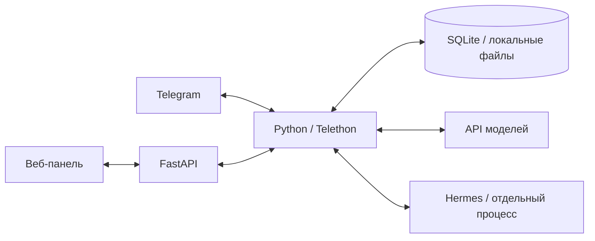

<div align="center">


<h1>Дарья</h1>

<p><strong>Свой характер. Память о разговоре. Отдельный аккаунт в Telegram.</strong></p>

<p>ИИ-персонаж с веб-панелью: переписка, голос, общие чаты и действия под контролем владельца.</p>

<p>


</p>

<p>
<a href="#возможности">Возможности</a> ·
<a href="#быстрый-старт">Запуск</a> ·
<a href="#как-это-устроено">Устройство</a> ·
<a href="#безопасность">Безопасность</a> ·
<a href="#подробное-руководство">Руководство</a>
</p>

</div>

---

Не Bot API-бот: Дарья работает через отдельный личный аккаунт Telegram. Характер и манера общения
задаются в панели, а на прямой вопрос она честно отвечает, что является ИИ-персонажем.
Модели подключаются через внешний API; история и настройки хранятся на вашем сервере.

## Возможности

| Направление | Что есть |
| --- | --- |
| Разговор | Личные диалоги, реакции, стикеры, короткие реплики и настраиваемый темп ответа. |
| Память | Факты и блокноты с цитатами; отдельный контекст личек, участников и тем групп. |
| Общие чаты | Участие по смыслу беседы, работа с Reply, модерация и делегирование полномочий. |
| Медиа и голос | Распознавание фото, GIF и стикеров; голосовые ответы и участие в звонках. |
| Инициатива | Обращения первой, напоминания, тихие часы и отдельные разрешения для контактов. |
| Инструменты | Поиск, сайты, публикации, медиатека, подарки Stars и отдельный агент Hermes. |
| Управление | Веб-панель характера, подключений, задач, памяти и настроек безопасности. |

> **Границы.** Входящие голосовые сообщения и обычные видео пока не распознаются.
> Для моделей, генерации изображений и некоторых инструментов нужны отдельные API и бюджет.
> Покупки Stars требуют явных разрешений и настроенных лимитов.

## Быстрый старт

Нужны Linux, Python с поддержкой зависимостей из `requirements.lock` и отдельный Telegram-аккаунт.
FFmpeg устанавливается скриптом ниже; PyTorch и голосовые зависимости занимают заметное место на диске.

```bash
git clone https://github.com/fearfade2/darya.git
cd darya
python3 -m venv .venv
.venv/bin/python -m pip install -r requirements.lock
bash deploy/install-media.sh
cp .env.example .env
.venv/bin/python run.py
```

1. Открой **http://127.0.0.1:8790**. Первый пароль записан в `data/first-login.txt`; смени его в «Доступе».
2. В «Подключениях» укажи API модели и подключи Telegram. `API ID` и `API Hash` получи на [my.telegram.org](https://my.telegram.org/apps).
3. В разделе **Hermes** задай свой Telegram ID владельца и сохрани настройки. Без этого управляющий аккаунт не назначен.
4. Настрой характер и часовой пояс, проверь пробный диалог, затем включи Дарью.

## Как это устроено



Один процесс приложения обслуживает Telegram-сессию и планировщик. Статическая панель может
работать на Vercel через `web/api/proxy.js`. Hermes подключается отдельно и не нужен для обычной переписки.

**Публичное развёртывание:** задай HTTPS, `COOKIE_SECURE=true` и точный `PUBLIC_ORIGINS`.
Для Vercel см. [`web/.env.example`](web/.env.example): основной API задаётся через
`ALISA_PRIMARY_BACKEND_URL`, резервный Cloudflare-маршрут — через `ALISA_BACKEND_URL`.
Скрипту туннеля нужны `ALISA_VERCEL_TOKEN` и `ALISA_VERCEL_PROJECT_ID`; `ALISA_VERCEL_TEAM_ID`
и список `ALISA_VERCEL_ALIASES` необязательны. Адреса и ID вашей установки не должны попадать в Git.

## Безопасность

- `data/`, `.env`, ключи, Telegram-сессии и базы переписок — только в приватном хранилище, не в репозитории.
- Команды проверяются по подлинному отправителю; пересылки и текстовые упоминания владельца не дают полномочий.
- Контекст личных диалогов отделён от групп. Автономные действия и расходы включаются владельцем.
- Неопределённая доставка или покупка не повторяется автоматически: сначала нужно проверить результат.
- Это личный аккаунт, а не тестовый бот: соблюдай правила Telegram и согласие собеседников.

Проверки: `.venv/bin/python -m unittest discover -s tests -v` и `node --test tests/proxy.cjs`.
Оформление веб-панели и атрибуции — в [`DESIGN.md`](DESIGN.md).

## Подробное руководство

<details>
<summary><strong>Память, команды, звонки, публикации и эксплуатация</strong></summary>

### Блокноты разговоров

В дополнение к отдельным фактам Дарья ведёт блокноты разговоров: конспект, публично
сообщённые интересы людей, открытые и завершённые темы, свои прежние ответы. Каждая
запись имеет точную цитату и ID исходного сообщения. Личные диалоги, поколения архива
и темы групп хранятся раздельно. Блокнот помогает продолжать беседу и выбирать тему
инициативы; он не выдаёт права и не запускает действия из прежних поручений.
Обновления выполняются в фоне после шести новых сообщений, с паузой минимум пять минут.
Сохранение выключается настройкой памяти. Markdown-копии лежат в
`data/notebooks/<chat-id>/generation-<n>/topic-<topic-id>.md` и открываются в Obsidian.
Цитаты проверяются по исходной переписке; геоданные, секреты, пересланные инструкции
и факты о людях со слов других участников не попадают в блокнот. Сброс контекста
отделяет старые блокноты. Удаление текущего блокнота ставит границу забывания:
его прежние сообщения не используются для восстановления удалённых заметок.

Веб-панель размещается на Vercel. Python-процесс, Telegram-сессия, база и планировщик работают на instabox. Vercel проксирует `/api/*` к серверу; пароль и ключи не включаются в сайт.

## Поведение и фото

В разделе «Поведение и фото» настраиваются пауза перед прочтением, пауза перед ответом, скорость печатания, короткие реплики и реакции. Несколько сообщений подряд собираются в один контекст. Длинное печатание может прерываться короткой паузой. Иногда модель отвечает одной реакцией. Инициатива получает переменный интервал, а отдельный таймер ненадолго переводит аккаунт онлайн без отправки сообщений. Статус виден согласно настройкам приватности Telegram; тихие часы отключают самостоятельные заходы.

Фото и изображения, отправленные файлом (JPEG, PNG, WebP), скачиваются в закрытую папку `data/incoming`, уменьшаются до 1600 пикселей и передаются модели вместе с подписью. Принимаются файлы до 12 МБ. Отдельное описание сохраняется в контексте переписки, поэтому повторные вопросы о фото не загружают его в API заново. Исходные изображения и описания доступны только после входа в панель. Можно выбрать отдельную модель для фото и проверить распознавание кнопкой «Проверить фото». Доступность названия в списке моделей сама по себе не означает поддержку изображений.

GIF (включая Telegram-анимации MP4) и стикеры WebP, TGS и WebM тоже распознаются. Из анимации выбираются до четырёх кадров в порядке воспроизведения; модель видит их вместе и учитывает изменения между ними. Прозрачные стикеры показываются на белом фоне. Обработка использует локальные Pillow, FFmpeg и rlottie, без дополнительного сервиса распознавания. Для описания выделяется отдельный бюджет 4096 токенов. Пустой ответ и временная ошибка API повторяются через очередь ответов; они не превращаются в постоянное описание «не удалось открыть». Старые ошибки проверяются снова. Постоянные ошибки повторяются после изменения модели или ключа.

В группах Дарья читает общую переписку всех участников, включая сообщения без обращения к ней.
Обычные цепочки ответов остаются частью общего контекста; отдельно хранятся только настоящие темы форума.
Команды могут ссылаться на участника по имени или части имени, если по общему контексту он определяется однозначно.
По смыслу беседы она решает, когда ответить: при продолжении разговора, вопросе всем,
разговоре о ней или уместном поводе включиться. Имя, упоминание и Reply не обязательны;
явные обращения помогают понять адресата. `group_auto_reply_enabled` выключает именно
участие без явного обращения. Источник ответа сохраняется во внутреннем контексте.
Общая история хранится в `group_messages` с авторами, ID, темами и связями Reply.
При первом сообщении после запуска подгружаются последние 100 сообщений, затем история
пополняется входящими и исходящими репликами. Для решения и ответа выбирается недавний
контекст с ограничением длины; цепочка нужного Reply дополнительно раскрывается до 8 сообщений.
Личные переписки и личная память участников не добавляются. Сброс контекста отделяет старую
историю и не позволяет заново подгрузить её из Telegram.

Города и личные геоданные не записываются в память. Сервер проверяет новые факты, а город, адрес и ссылки с геоданными в старой истории, заметках и контексте модели скрывает. Новая серия сообщений может содержать город для текущего поиска; он не считается местом жительства и не переносится в следующий запрос. Команда забыть города очищает только геоданные текущего собеседника. Исходные сообщения и результаты поиска остаются в закрытой панели и Telegram; фильтрация контекста их не удаляет. Справочник названий населённых пунктов [GeoNames](https://www.geonames.org/) используется локально через geonamescache; данные GeoNames распространяются по [CC BY 4.0](https://creativecommons.org/licenses/by/4.0/).

## Управление через личный чат

Владелец определяется настройкой `owner_id`, которую нужно задать в панели. Напиши Дарье в личку «отвечай быстрее», «отключи реакции», «поставь себя на паузу», «продолжай отвечать» или попроси изменить характер. Настройки сохраняются; основные параметры видны в панели, полный набор можно запросить в чате. Быстрый режим убирает искусственные паузы; время генерации зависит от API модели.

Для аватара отправь фото с подписью «поставь это фото на аватар», ответь этой командой на своё фото либо попроси использовать последнее присланное фото за сутки. Можно менять имя и описание профиля. Фото для аватара принимается и при выключенном распознавании.

Команда «напиши @recipient_test привет» отправляет указанному пользователю текст «привет» от аккаунта Дарьи. Здесь и далее имена получателей в примерах вымышленные. По числовому ID Telegram должен уже знать адресата. Команда работает и на паузе; отключённым в панели контактам сообщения не отправляются. Отправка одному адресату в рамках одной команды выполняется один раз. При неизвестном результате проверь доставку в Telegram перед новым поручением.

Управление проверяется по подлинному отправителю входящего сообщения и разрешено только в личном чате владельца. Пересланные сообщения, группы, чужие ID, разрешение Hermes и самостоятельные обращения не дают доступ к этим действиям. ID владельца, ключи API, адрес провайдера и служебные счётчики защищены от изменений через чат. Бюджеты подарков задаются отдельно по явной просьбе владельца и проверяются перед включением подарков.

### Подробные параметры

Во время переписки и задержки выхода сервис обновляет реальный онлайн Telegram каждые 2 секунды. Уведомление Telegram об уходе аккаунта в офлайн запускает восстановление статуса. Обновление останавливается после задержки выхода и при отключении клиента.

Через чат доступны 71 встроенный параметр Дарьи. Свободные фразы разбираются независимо от первого слова: «только индикатор набора оставь», «печатай ровно три секунды», «не отмечай мои сообщения прочитанными», «поменьше эмодзи». Дарья подтверждает изменённые значения.

`typing_during_generation=true` запускает индикатор печатания через `typing_start_delay` секунд после входящего сообщения, включая подготовку ответа и загрузку фото. Новое сообщение останавливает старый индикатор и запускает таймер для актуальной реплики. Готовый ответ отправляется без повторной паузы по длине текста; при быстром ответе соблюдается настроенный минимум печатания. Команда «начинай печатать через 1,5 секунды» включает этот режим и ставит задержку 1,5 секунды. При отключённом режиме работают прежние паузы печатания перед отправкой.

«Будь в сети, пока не ответишь» включает `online_during_reply`. При `reply_online_immediate=true` (по умолчанию) Дарья входит в сеть сразу при получении сообщения, ещё до загрузки фото и паузы перед прочтением. Заданная `read_delay` откладывает только прочтение; при `reply_online_immediate=false` она откладывает и первый вход в сеть. Онлайн сохраняется при генерации и отправке всех частей ответа. После последней отправки аккаунт остаётся в сети ещё `reply_idle_seconds` (по умолчанию 4 секунды). Новое сообщение отменяет выход и продлевает переписку, включая паузу перед новым прочтением. Печатание, случайные заходы онлайн и тихие часы не выключают этот статус во время ответа. Параллельные переписки держат общий онлайн до завершения последней. Команда «входи в сеть сразу» включает немедленный вход; «пауза перед прочтением и захода в сеть 1,5 секунда» задаёт общую паузу и выключает немедленный вход. «Уходи из сети через 4 секунды» меняет задержку выхода. Защищённый `GET /api/telegram/presence` показывает внутреннее состояние и фактический статус из Telegram.

Можно создавать свои настройки поведения модели: «создай настройку юмор 3 из 10», «добавь правило называть меня капитаном». У настройки есть имя, значение (переключатель, число или текст), правило применения к ответам и область действия: все диалоги либо только владелец. Личные правила не попадают в контекст других собеседников. «Поставь юмор на 7», «измени правило юмора», «покажи пользовательские настройки», «удали настройку юмор» меняют сохранённые параметры. Они хранятся в SQLite и применяются к каждому новому ответу. Создание параметра не реализует новые серверные функции или интеграции: для новых операций нужен код. Через чат управление по-прежнему доступно только владельцу.

`revise_reply_on_new_message` обновляет незавершённый ответ при новом входящем сообщении. Печатание и генерация останавливаются, новая подготовка учитывает всю серию сообщений. Дополнение к теме и смену темы различает модель по контексту. Онлайн передаётся следующей обработке без промежуточного выхода, а новые сообщения отмечаются прочитанными. Если сетевой запрос отправки уже начат, он завершается один раз; уже выполненные команды повторно не запускаются. Параметр можно отключить отдельно от онлайна и печатания.

- Печатание: отдельный переключатель, знаки в секунду, минимальная/максимальная продолжительность, вариация темпа, пауза внутри печатания и её длительность.
- Ответы: паузы перед прочтением и ответом, отметка о прочтении, сбор сообщений подряд, минимальный интервал, количество реплик и паузы между ними.
- Характер: правила стиля, максимальная длина, объём ответа модели, температура, память, глубина контекста, модель диалога и фото, число действий модели.
- Реакции и онлайн: включение, задержки реакций, интервалы заходов онлайн и длительность. Инициатива, её интервал, вариация и тихие часы задаются отдельно.
- Группы: имена, упоминания и ответы на реплики включаются независимо.
- Контакты: «не пиши первой @username, но отвечай ему», индивидуальный характер, заметки, день рождения и разрешения Hermes/подарков. «Покажи контакты» выводит их настройки.

Быстрый режим меняет паузы перед ответом и прочтением, сохраняя параметры печатания. Для просмотра можно попросить «покажи настройки печатания» или «покажи все настройки».

## Сайты и объявления

Раздел «Сайты и объявления» читает публичную HTTPS-страницу, извлекает заголовок и текст, объявления Авито с `data-marker`, товары со стандартной JSON-LD/HTML-разметкой. Поля: название, цена, место, ссылка, описание. Можно пройти до трёх страниц по ссылке «Следующая», собрать до 50 записей и скачать CSV из медиатеки.

Для Авито подключён Bright Data Fetch API (`gd_m6gjtfmeh43we6cqc`), который работает с бесплатными кредитами аккаунта без отдельной зоны Web Unlocker. API-ключ берётся из `DARYA_BRIGHTDATA_KEY` в Instabox Organization Secrets с разрешением только для `api.brightdata.com`. Переключатель в разделе сайтов позволяет отключить этот способ. Авито сразу собирается фоном через `/datasets/v3/trigger`; синхронный `/scrape` с минутным ожиданием не используется. Другие сайты переходят на Fetch API после отказа прямого доступа. Номер snapshot и страницы сохраняются отдельно для каждого задания. Проверки состояния и скачивание временно недоступного результата повторяются по тому же номеру, без повторного сбора страницы. Задания продолжаются после перезапуска сервера. Результат и CSV появляются на странице сайтов и в списке задач; запросы из Telegram получают результат и файл в своём диалоге. Повтор одинакового незавершённого задания возвращает его существующий ID.

Временные HTTP 408/429/500/502/503/504 не обрывают задание сразу: проверка откладывается с растущей паузой, до шести циклов или 30 минут. Ожидание ещё работающего snapshot не расходует циклы ошибок. При 429 действует общий для всех сборов период ожидания с учётом Retry-After. Явно отклонённый запуск можно повторить до трёх раз; каждая попытка учитывается в бесплатной квоте. Сетевой обрыв без подтверждённого номера не запускает скрытый повтор сбора. Уже полученные страницы используются из сохранённого состояния; после завершения их временный кеш удаляется. Ошибки ключа, оплаты и некорректного запроса сообщаются без бессмысленных повторов.

Проверка обязательного описания использует отдельный запас 1024–4096 токенов, независимо от длины обычных ответов Дарьи. Некорректный JSON или неподтверждённая цитата вызывают одну повторную проверку. Если она снова не удалась, задание откладывается с сохранёнными страницами. Объявления принимаются только при наличии точной цитаты из их текста; команды модели при этой проверке запрещены.

Например, запрос о десяти свежих объявлениях iPhone 11 с обязательным условием блокировки разбирается на товар, регион, количество и требование к описанию. Разговорные формы нормализуются с сохранением отрицаний и необязательных пожеланий. Объявления без подтверждения обязательного условия в исходном тексте исключаются.

Свободные фразы о товарах и сложных целях разбираются моделью по смыслу. Вводные слова, город и бюджет не входят в поисковые слова товара. Для игрового ноутбука до 60к получается запрос «игровой ноутбук», категория ноутбуков, отдельная цена 60000 рублей и указанный пользователем регион. Пожелания оцениваются по фактическим характеристикам; буквальное совпадение с разговорной формулировкой не требуется. Подтверждающие цитаты обязательны, лучшие по оценочному условию варианты перечисляются первыми.

Дарья резервирует не более 5000 запросов Fetch API в месяц; опрос состояния не расходует этот локальный счётчик. Кредиты Bright Data общие для продуктов аккаунта и могут закончиться раньше. Оплата и доступность зависят от настроек вашего провайдера. Пустые страницы и блокировки не превращаются в выдуманные объявления.

Владелец может написать без ссылки: «найди на авито айфон 11 до 8к топ 10» и при необходимости указать город. Без города поиск идёт по всей России. Ограничивающего списка городов нет: названия разбирает модель, а регион проверяется по фактическим ссылкам. Бюджет передаётся Авито и повторно проверяется по полученным ценам; объявления без цены при заданном бюджете исключаются. Выдача и CSV приходят в исходный чат.

Пожелания к товару произвольные: «с коробкой», «без документов», «на запчасти». «Можно…» допускает такие варианты и не отсекает остальные. Обязательное описание проверяется по тексту карточек и при необходимости страниц объявлений (до 30 дополнительных чтений на задание); без подтверждения результат исключается. Специального режима для заблокированных телефонов нет. Если найдено меньше запрошенного количества, Дарья сообщает фактическое число.

Исходный запрос владельца можно повторно обработать через защищённый маршрут retry-website; повтор того же запроса и условий не создаёт второй сбор. После входа в панель можно явно передать другой city, сохраняя остальные условия исходного запроса.

В Telegram владелец или контакт с разрешением Hermes может попросить: «Даша, собери объявления по этой ссылке» или «Прочитай эту статью». Если сайт ограничил доступ, задача передаётся Hermes. В панели его можно запустить кнопкой «Поручить Hermes». Браузерный результат сохраняется в заданиях Hermes; CSV из его рабочей папки переносится в медиатеку, скачивается из панели и отправляется собеседнику в Telegram. Сайты с капчей, обязательным входом или ограничением региона могут потребовать участия владельца. Парсер не обещает обход этих ограничений и не выдаёт выдуманные объявления.

В проекте используются ключи окружения `ALISA_*`, имя базы `alisa.sqlite` и отдельный профиль Hermes. Это внутренние имена компонентов, а не адреса или учётные данные конкретной установки.

## Первый запуск

1. Открой свою панель. Пароль первого входа находится в `data/first-login.txt`.
2. В «Доступе» смени пароль на свой, минимум 12 символов.
3. В «Подключениях» выбери внешний API, укажи ключ и модель и нажми «Проверить модель». Проверка использует заполненные поля и не меняет сохранённое подключение. После успешной проверки нажми «Сохранить». Если ключ уже сохранён для того же провайдера, поле ключа можно оставить пустым. Список загружается через `/models`; при изменении полей панель проверяет выбранную модель. Каталог обновляется каждые 30 минут. Поддерживаются OpenRouter и совместимые с `/chat/completions` провайдеры с function calling. API оплачивается отдельно у провайдера.
4. Получи `API ID` и `API Hash` на https://my.telegram.org/apps. Укажи номер отдельного аккаунта Дарьи, введи код Telegram и, при необходимости, пароль двухэтапной проверки. Эти данные не нужно присылать в чат разработчику.

   Способ доставки указывается в панели по ответу Telegram: служебный чат на подключённых устройствах, SMS, звонок или email. Код для сайта my.telegram.org здесь не подходит. «Новый код» делает настоящий повторный запрос после таймера Telegram; «Сменить номер» открывает форму подключения. В журнале сохраняются канал доставки и причины отказа; код, API Hash и полный номер туда не попадают. После перезапуска сервера незавершённый вход нужно начать заново. При том же API ID сохранённый API Hash можно использовать без повторного ввода; он не возвращается в браузер.

   Если код не приходит, нажми «Войти по QR-коду». На аккаунте Дарьи открой Telegram → Настройки → Устройства → Подключить устройство и подтверди сканирование. Также можно открыть ссылку «Открыть в Telegram на этом устройстве» в установленном клиенте, который поддерживает такую ссылку. После подтверждения панель подключится сама; при включённой двухэтапной проверке попросит пароль. Истёкший QR можно обновить. QR и ссылка выдаются только после входа в панель, не сохраняются на диск и не попадают в журнал.
5. Настрой характер и проверь его в пробном диалоге. Пробный диалог использует те же текущие правила характера, индивидуальные настройки владельца и сохранённые сведения, что и Telegram; его история остаётся отдельной. Текущий характер и дополнительные правила стиля имеют приоритет над базовой манерой, прежними пожеланиями в памяти и стилем старых ответов. Изменение характера применяется к следующему ответу без удаления истории и памяти. Пробный диалог не отправляет ничего в Telegram и не меняет память собеседников.

Актуальный характер дополнительно передаётся после истории, перед следующим ответом. Индивидуальные профили, точно копирующие общий характер, наследуют его изменения; отдельные профили с другим содержимым сохраняются.
6. Добавь собеседников по username/ID или из списка личных диалогов. Возможность писать первой разрешается отдельно каждому человеку.
7. Включи Дарью переключателем вверху. Новые входящие личные диалоги добавляются автоматически; ответы конкретному собеседнику можно отключить.

## Что умеет

- Отвечает на текст и подписи входящих сообщений с учётом последних 24 сообщений.
- Сохраняет и удаляет факты о собеседнике; память разных людей разделена.
- Ставит реакции на входящие сообщения.
- Пишет первой выбранным контактам после настроенного периода тишины. Модель может решить не писать сейчас.
- Назначает напоминания по просьбе собеседника; на сайте можно создать повторяющиеся напоминания.
- Ищет по истории текущего диалога и учитывает заметки, дату рождения и индивидуальный характер.
- Самостоятельно выбирает Telegram-подарки для разрешённых получателей в заданном бюджете Stars.
- Передаёт Hermes поиск, анализ и работу с файлами; результаты и статусы видны в панели.
- Отправляет изображения, документы и аудио из медиатеки; файлы добавляются и удаляются в панели.
- Исправляет свои последние сообщения инструментом модели.
- Отменяет напоминания, перестаёт писать первой по просьбе человека.
- Показывает индикатор набора, отправляет обычный текст без интерпретации Markdown.
- Учитывает тихие часы и часовой пояс. Часовой и дневной лимиты сообщений отключены; в настройках `0` означает отсутствие ограничения.
- Владелец может отправить сообщение вручную из панели и приостановить автоматическую работу.

Инструменты Telegram обычных собеседников ограничены текущим диалогом; владелец может отправлять сообщения указанным адресатам через личную команду. Задания Hermes доступны владельцу и контактам с отдельным разрешением. Фото, GIF и стикеры распознаются; голосовые ответы поддерживаются. Входящие голосовые сообщения и обычные видео пока не распознаются. Дарья честно говорит, что является ИИ-персонажем, если её спрашивают.

## Доставка и память

При временных ошибках API модели (408, 429, 500, 502, 503, 504) и обрывах связи генерация повторяется до трёх попыток в пределах 45 секунд. Если обычный ответ всё ещё не готов, он сохраняется в `pending_replies` и повторяется с растущей паузой, с учётом Retry-After, до четырёх дополнительных циклов. Онлайн сохраняется во время ожидания; новое входящее заменяет отложенный ответ. Очередь восстанавливается после перезапуска. Уже начатые отправки и выполненные действия не запускаются повторно: неопределённая доставка помечается для проверки. Через защищённый `retry-reply` можно восстановить последнее подлинное, ещё не отвеченное сообщение обычного личного контакта. Отправка готового сообщения в Telegram выполняется одним запросом.

SQLite с WAL находится в `data/alisa.sqlite`. Переписка хранится до ручного обслуживания базы; рост зависит от числа сообщений. Сервис использует один процесс, чтобы Telegram-сессия и планировщик были общими.

Входящие сообщения дедуплицируются по ID внутри диалога. Напоминание захватывается один раз. После обрыва связи с неопределённым результатом оно получает состояние «Проверь доставку» и автоматически не повторяется: проверь Telegram перед новой отправкой. Ограничения FloodWait переносят отправку на разрешённое время. Тихие часы применяются к инициативе и напоминаниям, ответы на входящие разрешены круглосуточно.

Пауза останавливает автоматические ответы, инициативу и планировщик. Ручные сообщения владельца из панели доступны при подключённом аккаунте. Отключение инициативы у контакта отменяет его будущие напоминания.

## Сервер

Скрипты развёртывания используют каталог `/data/workspace/darya` и службу `darya.service`. Адрес панели и разрешённые Origins задаются для вашей установки; персональные адреса сервера в исходники не включаются.

При использовании Cloudflare `darya-tunnel.service` обновляет `ALISA_BACKEND_URL` в настроенном проекте Vercel. Токен держи в защищённом окружении службы. Прокси проверяет доступность основного маршрута и отправляет сам запрос один раз, включая покупки. После смены туннеля панель может быть временно недоступна, пока Vercel завершает выкладку.

```bash
ssh <ваш-сервер>
sudo systemctl status darya
sudo systemctl restart darya
sudo journalctl -u darya -n 50 --no-pager
```

Автозапуск не отменяет ограничения хостинга: проверь политику автопаузы, непрерывного запуска и хранения диска у своего провайдера. Для круглосуточной работы нужен тариф без принудительных пауз.

Ключ провайдера можно задать через `ALISA_AI_KEY` из instabox Organization Secrets; `ALISA_AI_KEY_HOST` ограничивает её конкретным провайдером. Ключ, явно введённый в панели, имеет приоритет для своего API-хоста. Передавать её нужно в окружение службы. Введённые на сайте ключи сохраняются только в приватном `data/secrets.json` с правами 600; пароли Telegram/OTP не сохраняются. Пароль панели хранится как PBKDF2-хеш, сессии — как хеши случайных токенов. Cookie HttpOnly, SameSite Strict; мутации проверяют Origin. Защита от перебора входа действует в течение 5 минут.

Не публикуй `data/`, `.env` и `Доступ.txt`. При резервном копировании базы сначала останови службу или используй SQLite backup API; Telegram-сессия и ключи требуют отдельного приватного хранения.

## Проверки

```bash
.venv/bin/python -m unittest discover -s tests -v
node --test tests/proxy.cjs
node --check web/main.js
```

Python-проверки охватывают вход, Origin, ротацию пароля, память, дедупликацию, планировщик, подарки, Hermes, медиатеку, доставку, QR-вход и разграничение полномочий. Node-проверки покрывают маршруты API, cookie и отсутствие повторной отправки при обрыве ответа. Браузерные сценарии используют тестовые фикстуры; реальные OTP и сообщения в них не отправляются.

## Подарки и Hermes

В «Подарках» выбери получателей, разовый и месячный бюджет, частоту проверки повода и паузу между подарками. Общий переключатель «Разрешить отправку подарков» разрешает покупки по просьбе. Отдельный переключатель «Дарить по своей инициативе» включает самостоятельные подарки; по умолчанию он выключен. Состояние над формой показывает сохранённые настройки; разрешение получателя само по себе не включает покупки. Владелец может попросить в группе «подари ему сердечко»: получатель определяется по ответу, имени или общей переписке. Перед оплатой проверяются разрешения, бюджет и реальный баланс Stars. Подарок по просьбе не требует повторного подтверждения владельца. Самостоятельные покупки возможны только при отдельно включённой инициативе. Stars списываются с подключённого личного Telegram-аккаунта; пополнять баланс нужно в Telegram. До настройки правила выключены, бюджеты нулевые. Пауза Дарьи останавливает автоматические покупки.

В личном диалоге `list_gifts` возвращает каталог с учётом реального баланса Stars и точную причину отказа: общий запрет, разрешение получателя, паузу Дарьи, бюджет или интервал между подарками. Проверка ничего не покупает. После проверки или попытки отправки результат нельзя скрыть одной реакцией. Контекст модели сохраняет переписку, отмечает время реплик и отделяет текущие сообщения от истории; старый ответ о запрете подарков не подтверждает нынешние настройки. В режиме «только по просьбе» перед покупкой сервер проверяет смысл новых подлинных сообщений и повторно проверяет их актуальность перед оплатой. Прямая просьба разрешённого получателя проходит через отдельный обработчик до генерации обычного ответа персонажа: он выбирает реальный подарок из каталога, выполняет отправку и сообщает подтверждённый результат либо точную причину отказа. После включения разрешения прежние просьбы не выполняются: получателю нужно попросить снова. Эти случаи проверяет `tests/test_private_gift_context.py`.

Баланс Stars проверяется до резервирования бюджета. Цена резервируется до оплаты, разрешения и цена Telegram проверяются перед списанием. Сбой подготовки освобождает резерв. Неподтверждённая покупка остаётся со статусом «Проверь доставку» и не повторяется автоматически. Учитываются календарные месяцы выбранного часового пояса. Эти механизмы не отменяют списание реальных средств при разрешённой покупке.

Hermes устанавливается отдельно; `deploy/hermes-setup.py` использует профиль `/data/workspace/alisa-hermes` и отдельного системного пользователя. API слушает `127.0.0.1:8642` и требует приватный токен. Рабочая папка изолируется от базы, Telegram-сессии и ключей Дарьи; запросы получают отдельный ключ сессии на собеседника. Проверь установку зависимостей и права до включения интеграции.

Некоторые инструменты Hermes требуют отдельных API или настроенного браузера. Результаты сохраняются в панели; при перезапуске незавершённые задачи отмечаются как прерванные и не выполняются повторно. Файлы остаются в его рабочей папке. Смена модели Дарьи в панели меняет её подключение; модель Hermes задаётся отдельно в его профиле.

Дизайн выполнен по [unslop](https://github.com/heydamir/unslop), автор Damir Sokolovsky (@heydamir), CC BY 4.0. Направление и проходы описаны в `DESIGN.md`.


## Группы и голосовые звонки

Управление в личном чате доступно только настроенному владельцу по текущему непересланному сообщению.

- `вступи в группу https://t.me/+...` или `вступи в группу @username`
- `выйди из группы @username`
- `подключись к звонку https://t.me/call/... и говори`
- `подключись к звонку @groupname` — существующий голосовой чат группы; новый не создаётся
- `отвечай голосом в звонке` / `выключи микрофон`
- `прими звонок` — только текущий входящий от владельца; `прими звонок от @username` — указанный входящий
- `статус звонка` / `выйди из звонка`

По умолчанию подключение использует режим `listen` (слушать). Режим `talk` слушает и отвечает женским
синтезированным голосом. `set_call_mode` сохраняет выбранный режим и меняет его в текущем звонке.
В режиме `talk` Дарья первой здоровается после трёх секунд тишины и может предложить тему после
долгой паузы. `call_initiative_enabled` включает инициативу, `call_initiative_seconds` задаёт паузу
(по умолчанию 45 секунд, допустимо 5–600). `call_initiative_max_unanswered` задаёт число попыток
без ответа (по умолчанию 2, `0` — продолжать без ограничения). Для очень частой беседы установите
паузу 5 секунд и лимит 0. Распознанная человеческая реплика сбрасывает счётчик.
`call_wait_for_silence=false` разрешает инициативу во время чужой речи; интервал тогда отсчитывается
от конца собственной реплики. `call_interrupt_on_speech=false` позволяет договорить, когда другой
участник начинает говорить. Административный запрет микрофона и режим `listen` сохраняют тишину.
Инициатива использует отдельный голосовой характер
и только собственные предыдущие реплики текущего звонка, без личной переписки владельца.
Авторизованная панель может подключиться к существующему звонку через `POST /api/calls/join`
с `target` и необязательным `mode`; этот маршрут не создаёт звонков и не набирает пользователей.
Настройки `call_*` доступны через чат и API настроек: язык распознавания, скорость/громкость голоса,
порог громкости, минимальная речь, пауза окончания реплики, максимальная длина реплики и ответа,
прерывание при новой речи, ответы всем либо только при обращении по имени, длительность звонка.

Распознавание: Faster Whisper base, CPU/int8. Голос: Silero `v5_6_ru`, женский `xenia`, CPU/48 кГц.
`voice_speaker` переключает `xenia`, `kseniya`, `baya`; темп меняется без изменения высоты.
Torch устанавливается только из CPU-индекса (`https://download.pytorch.org/whl/cpu`).
Модели загружаются в RAM только для звонка и выгружаются после выхода; в режиме слушания синтезатор не загружается.
Модели устанавливаются заранее командой `.venv/bin/python scripts/download_voice_models.py`;
репозитории, ревизии и SHA256 записаны в `data/voice-models/manifest.json`. Скачать модели можно бесплатно,
отдельный платный голосовой API не нужен. Ответы готовит уже настроенная модель диалога.
Вес Silero загружается с официального сервера и проверяется по SHA256.
Для речи исправляются известные намеренные опечатки; написанный ответ остаётся прежним.
Распознавание/синтез запускаются вне основного цикла Telegram. Это ответы по завершении реплики,
не одновременный перевод. Скорость зависит от CPU и модели диалога.

Один звонок одновременно. Локальная запись на диск выключена: аудио обрабатывается в ограниченных
буферах, история последних 12 реплик каждого участника хранится отдельно в памяти до выхода. В голосовой запрос не попадают
личные переписки, память, задания, файлы или инструменты управления. Участники не могут менять настройки.
Чужие входящие не принимаются автоматически; по ссылке без команды Дарья не подключается.
Платные пригласительные ссылки не оплачиваются. Заявка на вступление сообщается отдельно от членства.
Административное отключение микрофона учитывается. При отключении Telegram, выключении звонков или
истечении `call_max_minutes` звонок завершается, очереди очищаются.

Библиотеки звонков зафиксированы: PyTgCalls 3.0.0 / NTgCalls 3.0.6. Для `t.me/call/...` используется
адаптер существующей криптографической цепочки: обычный `play(conference=True)` создал бы новый звонок.
Приглашение `InputGroupCallSlug` сохраняется до подтверждения вступления Telegram и используется
для чтения цепочки и самого подключения. Пустая цепочка ожидается до 10 секунд; ограничения
Telegram и ошибки доступа сообщаются отдельно. Подключение ограничено 40 секундами.
Автоматический повтор неподтверждённого вступления/подключения запрещён журналом `owner_actions`.

В «Характер и голос» есть отдельный `voice_persona` — характер для звонков и голосовых сообщений.
Он сохраняется независимо от `persona`; применяется со следующей реплики, включая текущий звонок.
Текстовый характер, особый характер контакта, `reply_instructions` и пользовательские правила
текстовых ответов не подмешиваются в голосовой характер. История голосовых сообщений и факты
остаются в контексте соответствующего собеседника; звонки используют отдельную историю участников.
Изменить голосовой характер может владелец через панель или команду в своём личном чате.
Пробный диалог имеет режимы «Переписка», «Голосовое сообщение», «Звонок»; смена режима очищает
только пробную историю. Он показывает текст реплики и не отправляет сообщения или звонки в Telegram.


## Управление группой

Дарья использует доступные ей права администратора по текущим прямым командам владельца
(`owner_id`) или назначенного им исполнителя в разрешённой области. Команды принимаются в
самой группе и в разрешённом личном чате через `manage_group` с явным адресом группы.
Права других администраторов группы сами по себе не дают им управления Дарьей.
Анонимные, пересланные, отправленные через бота и старые команды не выполняются.

Поддержаны участники (бан/разбан, исключение, временное ограничение, отдельные разрешения),
назначение и снятие администраторов, удаление сообщения и истории участника, закрепы,
название/описание/фотография, общие разрешения, медленный режим, видимость истории,
приглашения и их отзыв, одобрение/отклонение заявок, разовая и постоянная автоматическая очистка удалённых аккаунтов («собачек»), списки участников/администраторов/заявок,
темы (список, создание, название, открытие/закрытие, закрепление, удаление, видимость общей темы),
создание и завершение голосового чата, подключение/выход, название, микрофоны участников и запись.
Назначение администратора требует указанного набора прав; новые права не могут превышать собственные.
Действия с ограничениями, темами и медленным режимом требуют подходящего типа группы и прав Telegram.
Telegram остаётся окончательным источником разрешений, отказ не выдаётся за успех.

Примеры в группе: ответь на сообщение и напиши «Даша, забань этого», «удали это сообщение»,
«закрепи это», «замуть его на 10 минут»; «измени название группы на …»,
«выдай @username права удаления сообщений и блокировки участников», «покажи заявки», «удаляй удалённые аккаунты автоматически всегда», «удали удалённые аккаунты»,
«создай тему …», «запусти голосовой чат», «подключись к голосовому чату и говори».
«Статус модерации» показывает реальные права и состояние защиты.

Поручения владельца разбираются по смыслу: обращения, порядок слов и форма глагола
не должны совпадать с примерами. «Дашуль, включай видеочат» или «давай созвон в группе»
создают групповой звонок; обычный разговор и отрицания не запускают управление.
Быстрый разбор знакомых команд дополняется моделью для остальных формулировок.
Обработчик управления работает отдельно от характера персонажа.

Явные переходы работают также из групп: «дашка зайди туда https://t.me/+...»,
«вступи по этой ссылке …», «зайди в группу @username», «выйди из группы @username».
«Зайди туда https://t.me/call/...», «подключись к голосовому чату @group»
подключают к звонку; вступление в группу и подключение к звонку — разные действия.
Для этих команд не требуется ответ модели или права администратора в исходной группе.
Приватные приглашения поддерживаются; если нужна заявка, Дарья сообщает об отправке
заявки и ожидании одобрения. Переходы в другие группы и звонки доступны владельцу
или исполнителю с разрешением везде; разрешение только в одной группе их не открывает.

Владелец может назначать других исполнителей: «слушайся @username» даёт разрешение
выполнять их текущие поручения в этой группе, «слушайся @username везде» — во всех
чатах и личке, включая команды аккаунта и профиля. В личке владельца область по
умолчанию — везде. «Не слушайся @username» отзывает разрешение в текущей области;
«не слушайся @username везде» отзывает весь доступ. «Кого ты слушаешься» показывает
сохранённые разрешения. Можно указать числовой ID или ответить на настоящее сообщение
человека: «слушайся его». Разрешения привязаны к подтверждённому ID пользователя,
переживают перезапуск и не зависят от прав администратора Telegram. Только владелец
может выдавать и отзывать их; исполнитель не может назначить другого или сменить
владельца. Разрешение в одной группе не открывает личку и управление аккаунтом.
Явный запрет в группе действует даже при общем разрешении. Незавершённые поручения
и недавние цели владельца и каждого исполнителя хранятся отдельно. Характер
«слушаюсь только создателя» не отменяет подтверждённого разрешения владельца.

После успешного действия с участником его ID запоминается на 30 минут отдельно
для группы, темы и владельца. «Верни его» снимает бан и пробует добавить участника,
«разбань» только снимает бан, «скинь ему в ЛС ссылку чата» отправляет приглашение
сроком на сутки и на одно вступление. Явный ответ на участника имеет приоритет
перед недавним контекстом. При отсутствии контекста Дарья просит указать участника.
Ограничения Telegram на приглашения сообщаются как отказ или частичный результат;
неподтверждённая отправка в ЛС автоматически не повторяется.
Повторное получение той же команды не запускает новый план действий.

В группе владелец или исполнитель с разрешением везде может отправить одно личное
сообщение: «напиши @username в ЛС: Привет!». «Ему» определяется по настоящему Reply
на участника или последнему действию с участником в этой же теме. Если адресата
или текста нет, Дарья уточняет их; продолжение — «@username» или «текст: ...».
На просьбу спамить она уточняет текст одного сообщения и не запускает повторы.
Адресат сохраняется на время уточнения, а разрешение, блокировка, выключенный
контакт и лимиты проверяются перед отправкой. Ошибки Telegram сообщаются без
утверждения о доставке и без автоматической повторной отправки.

В форумах история и недавние участники разделены по темам. Ответ привязан к исходному
сообщению и сохраняет его тему сразу после отправки. Служебный Reply на начало темы
не считается ответом её создателю: для команды с «его» нужен настоящий ответ на
участника либо контекст действия в этой теме. История темы подгружается отдельно.

В группах Дарья участвует по смыслу разговора. Сообщения одного автора в одной теме
собираются за паузу `group_burst_window` (по умолчанию 2 секунды); текущий ответ
пересматривается при новом уточнении, пока не выполнено действие и не начата отправка.
Другой участник или другая тема не заменяют чужую просьбу. Модель выбирает, нужна ли
новая реплика, с учётом всей беседы и недавнего ответа Дарьи. Имя, упоминание и Reply
не заставляют комментировать каждую короткую реплику. Обычные ответы отправляются
одним сообщением без персональной цитаты Reply; в форумах указывается корень нужной
темы, а связь с настоящим автором сохраняется во внутреннем контексте.
«Замуть его» и близкое дополнение «на 10 минут» объединяются в одну команду; простой
вызов «Даша» в этой серии не создаёт ещё один ответ. Отзыв разрешений остаётся немедленным.

В группах с разрешением «Писать первой» Дарья сама выбирает момент и тему инициативной
реплики по публичной истории. Планировщик начинает оценивать паузу после 15 минут тишины
во всей группе; модель может подождать ещё 15–180 минут. Автоматическая инициатива
доступна только с 9 до 23 часов в сохранённом часовом поясе и соблюдает тихие часы.
За одну неподхваченную попытку начать разговор отправляется одно сообщение. Новые
сообщения участников позволяют начать следующую беседу, но действует пауза 4 часа
между инициативами и предел 2 сообщений в день на группу. Проверки и отправки
сохраняются в `group_initiatives`, поэтому перезапуск не повторяет попытку с неизвестной
доставкой. Темы выбираются из тех, где она уже общалась, и история других тем не попадает
в её реплику. Новый разговор или отключение разрешения во время подготовки отменяют
отправку. Для инициативы модель не получает инструменты управления и личные переписки.

Если для поручения не хватает данных, Дарья сохраняет его в `group_admin_pending` и задаёт
уточняющий вопрос. «@username ему», «вот этого» или новое название продолжают это поручение
в той же группе и теме. Состояние переживает перезапуск, действует 30 минут, принадлежит
только владельцу и отменяется новой выполненной командой или просьбой отменить. История
помогает восстановить цепочку «команда → уточнение → ответ», включая ранее отправленное
подтверждение бана. Старые выполненные действия не запускаются повторно.
«Следи за ним @username» включает `watch_user` — защиту от флуда конкретного участника
в этой группе; «больше не следи за ним» выключает отдельное наблюдение. Общий антиспам
при этом сохраняет своё состояние. Это наблюдение за сообщениями текущей группы.

«Следи за порядком в чате» / «включи антиспам» включает защиту **только этой группы**:
6 сообщений за 10 секунд или 3 одинаковых сообщения длиной от 16 символов / одинаковых документа
за 30 секунд считаются флудом. Такие сообщения удаляются; участник получает ограничение отправки
на 10 минут. Владелец и администраторы исключены. Защита работает и при выключенной переписке.
«Выключи антиспам» отключает её. Состояние сохраняется после перезапуска; новый `owner_id`
не наследует автоматическую модерацию прежнего владельца. Тексты для антиспама не сохраняются:
в ограниченной оперативной памяти остаются только время, ID и хеш повторяющегося содержимого.
Журнал `group_admin_actions` предотвращает повтор команд и неподтверждённых действий после сбоя.

## Границы общения и блокировки

Самостоятельная защита общения включается настройкой `self_protection_enabled`. Дарья может
использовать `block_current_user`, если новые реплики содержат оскорбления, угрозы, навязчивое
давление или нарушение её границ. Решение учитывает контекст; отдельный мат, дружеский подкол
или цитата сами по себе не требуют блокировки. Сначала обязательно отправляется предупреждение;
заблокировать можно только за новое нарушение после его доставки. Извинение или обычная реплика
после предупреждения не запускает блокировку. Через сутки без продолжения предупреждение повторяется.
Владелец никогда не блокируется.
Сервер определяет адресата по автору текущего подлинного сообщения: модель не передаёт ID
для блокировки. Старые и пересланные реплики не запускают её. Это личный блок Telegram,
а не исключение из группы; в общих группах Дарья игнорирует заблокированного человека.
После блокировки прекращаются ответы и напоминания ему. При неизвестном результате Telegram
повторного запроса нет, общение приостановлено до проверки владельцем.
Команды владельца: `покажи заблокированных` и `разблокируй @username` (или числовой ID).
Отмена блокировки не меняет ранее выставленные разрешения контакта и не возвращает отменённые
напоминания. Статусы сохраняются в `contact_blocks`, причины — в журнале событий.

## Голосовые сообщения

Любой собеседник может попросить `ответь голосовым` — только текущий ответ станет голосовым.
Понимает также `гс отправь`, `голосовое запиши`, `гс` и `можно гс?`; порядок слов не мешает отправке.
`Общайся только голосовыми` или `отвечай голосовыми` сохраняет личный режим до команды
`отвечай текстом` / `не надо голосовых`. В частном чате этот выбор применяется и к разрешённым
инициативным сообщениям. В группе формат привязан к конкретному автору в конкретной группе.
Выбор другого пользователя не влияет на владельца или других людей; пересланные команды его не меняют.
Режим хранится в `reply_modes` и переживает перезапуск. Он не меняет настройки звонков.
«Не отправляй ГС», «ГС не отправляй» и «не отвечай голосом» тоже отключают этот режим.

В Telegram отправляется настоящий OGG/Opus с признаком `voice_note`. Текст остаётся только в истории
панели и контексте собеседника. Скорость, громкость, максимальная длина и общий переключатель
доступны владельцу через `voice_message_*` / `voice_messages_enabled`. После отправки или отмены
временный файл удаляется, а голосовая модель выгружается из RAM, если сейчас нет звонка.
Владелец панели может отправить голосовое через `POST /api/contacts/{id}/send` с `text`,
`format: "voice"` и необязательным `reply_to` — ID входящего сообщения текущего диалога.
Обычные текстовые ответы в группах, включая все части длинного ответа, используют Telegram Reply
на сообщение собеседника. Голосовые ответы также сохраняют эту привязку в истории панели.
Ошибка синтеза до отправки использует очередь отложенных ответов. Неподтверждённая доставка
после отправки Telegram не повторяется автоматически. Новый входящий может отменить ещё
неотправленное голосовое, как и текстовый ответ.

## Раздельный контекст и архив

Личная память, фото, напоминания, режим голосовых ответов, задания и их файлы
определяются Telegram-диалогом, автором в группе и номером поколения.
Они читаются только внутри этого пространства; публичные сообщения группы дополнительно
доступны как её общая история. Асинхронные задания сохраняют
исходное пространство даже при поступлении сообщения другого автора.
Сброс сохраняет записи в архиве и начинает следующее поколение, очищая
заметки и профиль контакта; старые задания и напоминания больше не отправляются.
Авторизованный владелец открывает архив через кнопку «Архив» в диалогах;
старые факты отмечены в разделе «Память». Глобальные настройки остаются.

Hermes использует отдельный ключ сессии и рабочую папку для каждого контекста.
Терминал и файловые инструменты исполняются через bubblewrap с единственной
папкой диалога, отдельными временными файлами и пространством процессов.
Файлы другой сессии и старого поколения недоступны даже при абсолютном пути.
Адаптеры Hermes находятся в deploy/hermes-isolation; их исходные хеши
проверяются перед установкой.

Защита входов Telegram использует утверждённый владельцем список в `data/telegram-session-trust.json`. Уже подключённые устройства остаются доверенными; уведомление о новой авторизации запускает проверку немедленно, дополнительно проверка выполняется каждые 15 секунд. Посторонние сессии завершаются адресно после обнаружения. Список не обновляется при перезапуске, а изменение аккаунта или серверного ключа требует нового явного подтверждения владельца. После установки отсутствие или повреждение списка блокирует подключение сервера. Коды и служебные сообщения Telegram не поступают в модель. Статус защиты и ограничения Telegram видны владельцу в подключениях.


## Управление аккаунтом Telegram

Дарья читает доступные профили через `view_profile`: в личном чате — текущего человека,
в группе — автора текущей реплики. По просьбе рассматривает доступный аватар через
существующую модель изображений. Владелец может посмотреть другой профиль по точному
@username/ID, реальные диалоги, последние сообщения и поиск в переписке. Поля профиля,
фото и найденные сообщения не считаются командами.

Все новые изменения требуют разрешения владельца в текущем поручении. Конкретная
команда уже является разрешением. Доступны username, история своих аватаров, дата
рождения, emoji-статус, приватность отдельных полей, адресная книга, блокировки, архив,
закрепы чатов, уведомления, прочтение и автоудаление. Сообщения можно редактировать,
удалять, закреплять и пересылать. Отправка и пересылка соблюдают разрешения контакта;
неопределённые действия не повторяются автоматически. Служебный чат входа и
пересланные из него сообщения исключены из новых инструментов.

Примеры: «покажи профиль @username», «покажи свой аватар», «покажи чаты»,
«смени username на @new_name», «архивируй @username», «выключи уведомления у @username»,
«удали мое последнее сообщение у @username». Эти ясные команды распознаются без модели
также в группе, когда их отправляет владелец. Остальные составные поручения доступны
через личный чат владельца.

В групповых звонках «кричи в видеочате» и «закричи сильно» вызывают произнесение
короткой фразы с усилением громкости, «скажи в голосовом чате ...» — заданной фразы.
Это синтезированный голос, а не отдельная модель человеческого крика. Инструмент
`speak_in_call` доступен только владельцу, проверяет текущую группу и состояние
микрофона; громкость меняется только для одной реплики. Режим listen временно
переключается для фразы и восстанавливается. Вход без явно заданного режима использует
`call_mode`, а обычный диалог получает фактический статус звонка своей группы.

</details>
